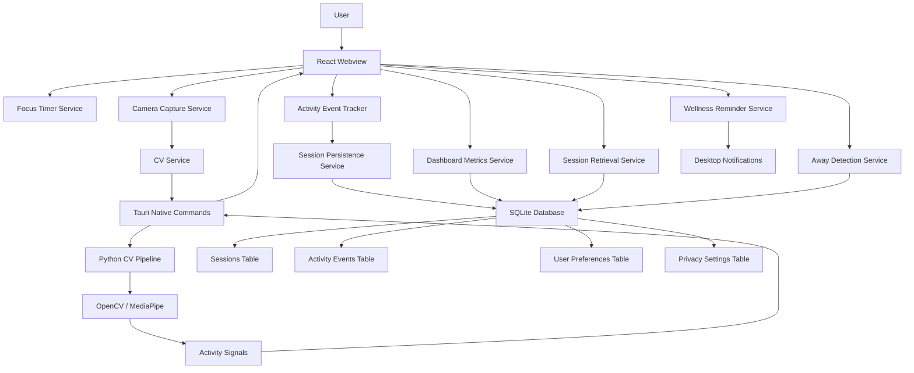

# FocusLens


**Privacy-First Computer Vision Productivity Assistant**

[FocusLens](https://github.com/SR-Digital-Labs/Focus-Lens) is a privacy-focused desktop productivity application that uses local computer vision to help users understand and improve their focus sessions. The application processes webcam data entirely on-device—no frames are stored or transmitted to external services.

FocusLens provides real-time activity indicators including person presence, screen-facing direction, posture monitoring, and session analytics—all while maintaining complete data privacy through local SQLite storage.

---

## Table of Contents

- [About FocusLens](#about-focuslens)
- [Key Features](#key-features)
- [Screenshots](#screenshots)
- [Technology Stack](#technology-stack)
- [System Architecture](#system-architecture)
- [Project Structure](#project-structure)
- [Installation and Setup](#installation-and-setup)
- [Running the Application](#running-the-application)
- [Download and Installation](#download-and-installation)
- [Privacy and Data Protection](#privacy-and-data-protection)
- [Team Members](#team-members)
- [Project Documentation](#project-documentation)
- [Future Improvements](#future-improvements)

---

## About FocusLens

FocusLens helps students, developers, and remote workers understand their work patterns through locally processed computer vision signals. The application combines a React-based user interface, a Tauri desktop shell, a Python/OpenCV/MediaPipe computer vision pipeline, and local SQLite storage.

**Privacy-First Architecture:**
- Webcam frames are processed locally by Python's OpenCV and MediaPipe
- Only derived activity metadata (presence, screen-facing, posture) is stored
- No raw webcam footage is persisted or transmitted to external services
- All data is stored in a local SQLite database on the user's machine

FocusLens is designed to provide calm, focused insights without making users feel monitored or judged. It presents computer-vision results as activity indicators rather than absolute productivity judgments.

---

## Key Features

### Focus Session Management
- **Focus Timer** (`src/pages/FocusSession.tsx`) - Customizable Pomodoro-style timer with presets (25, 45, 60, 90 minutes)
- **Session Lifecycle** - Start, pause, resume, and end focus sessions with accurate time tracking
- **Session Persistence** - Automatic saving of session state and progress to local database
- **Interrupt Handling** - Graceful session interruption when the application closes

### Computer Vision Activity Monitoring
- **Person-Presence Detection** (`cv/services/presence_reliability.py`) - Detects when the user is present or away from the camera
- **Away Detection** (`src/services/awayDetection.service.ts`) - Tracks away periods with configurable threshold (default 5 minutes)
- **Screen-Facing Estimation** (`cv/services/screen_facing_estimator.py`) - Estimates whether the user is facing the screen or looking away
- **Posture Monitoring** (`cv/services/posture_classifier.py`) - Detects slouched vs upright posture using ear-to-shoulder ratio
- **Activity-Event Tracking** (`src/services/activityEventTracker.service.ts`) - Records focused, distracted, and away events during sessions

### Focus Indicator
- **Real-Time Score** (`src/services/focusIndicator.service.ts`) - Calculates a focus score based on activity events
- **Visual Feedback** - Displays focus quality during active sessions
- **Session-End Summary** - Provides focus score and session outcome upon completion

### Session History
- **Session Retrieval** (`src/services/sessionRetrieval.service.ts`) - Retrieve and filter session history
- **Status Filtering** - Filter by completed, cancelled, interrupted, running, or paused sessions
- **Date Range Filtering** - View sessions by date range (today, last 7 days, last 30 days, all time)
- **Pagination** - Efficient pagination for large session histories
- **Session Details** - View detailed session information including duration, away time, and focus score
- **History Deletion** (`src/services/sessionHistoryDeletion.service.ts`) - Clear all session history with cascade deletion of activity events

### Productivity Analytics
- **Dashboard Metrics** (`src/services/dashboardMetrics.service.ts`) - Aggregated daily and weekly analytics
- **Daily Analytics** - Total focus time, sessions, away time, and average focus score by day
- **Weekly Analytics** - Aggregated metrics across the week (Monday to Sunday)
- **Outcome Distribution** - Session completion rate and outcome breakdown
- **Recent Sessions** - Quick view of the most recent focus sessions
- **Visual Charts** (`src/components/AnalyticsCharts.tsx`) - Bar charts for daily focus time and weekly distribution

### Camera and Privacy Controls
- **Camera Status** (`src/services/cameraCapture.service.ts`) - Real-time camera state display (active, inactive, permission denied, device unavailable)
- **Privacy Controls** (`src/components/PrivacyControlsSection.tsx`) - Configure camera usage and local video storage preferences
- **Camera Permission Handling** - Graceful handling of permission denied and unavailable states
- **Activity Signals** - Real-time display of person presence, screen-facing, and posture states

### Notification and Break Settings
- **Wellness Reminders** (`src/services/wellnessReminder.service.ts`) - Configurable break reminders (every 30, 45, 60, or 90 minutes)
- **Sleep Time** - Set daily sleep time to pause break reminders during rest hours
- **Notification Permissions** - Desktop notification permission management
- **Posture Reminders** - Posture change notifications during focus sessions

### Data Management
- **Away Threshold Configuration** - Customize away detection threshold (default 5 minutes)
- **Data Retention Settings** - Configure how long session history is retained
- **Privacy Settings** - Local video storage and camera usage preferences
- **Database Management** - Local SQLite database with schema migrations

### Local Persistence
- **SQLite Database** (`src-tauri/migrations/0001_initial.sql`) - Local database for sessions, activity events, user preferences, and privacy settings
- **Session Storage** - Complete session lifecycle including start/end times, elapsed duration, and paused duration
- **Activity Events** - Focused, distracted, and away events with timestamps and durations
- **CASCADE Deletion** - Automatic deletion of activity events when sessions are deleted
- **User Preferences** - Persisted user settings (away threshold, break intervals, etc.)
- **Privacy Settings** - Privacy-related configuration stored separately

---

## Screenshots

### TODO: Add Application Screenshots

The following screenshots should be added to the repository:

1. **Dashboard** - Main dashboard with daypart allocation, quick actions, and recent sessions
2. **Focus Session** - Active focus session with timer, camera status, and activity indicators
3. **Session History** - Session history table with filters and pagination
4. **Analytics Dashboard** - Productivity analytics with charts and metrics
5. **Settings** - Privacy controls, notification settings, and data management options

**Recommended screenshot location:** `public/screenshots/` or `docs/screenshots/`

---

## Technology Stack

### Frontend
- **React 19.2.8** - UI framework
- **TypeScript 6.0.2** - Type-safe JavaScript
- **Vite** - Build tool and development server
- **React Router DOM 7.18.4** - Navigation and routing
- **Lucide React 1.48.0** - Icon library

### Desktop Framework
- **Tauri 2.11.1** - Desktop application framework
- **Rust** - Native backend language
- **Tauri Plugin SQL 2.6.0** - SQLite database integration
- **Tauri Plugin Notification 2.6.0** - Desktop notifications

### Computer Vision
- **Python 3.10+** - CV scripting language
- **OpenCV 4.11.0.86** - Webcam capture and frame processing
- **MediaPipe 0.10.14+** - Local ML inference for face and pose landmarks
- **MediaPipe Face Landmarker Task** - Face detection and landmark extraction
- **MediaPipe Pose Landmarker Lite Task** - Upper-body pose detection

### Backend / Local Processing
- **SQLite** - Local database storage
- **@tauri-apps/plugin-sql** - Tauri SQLite plugin
- **sql.js 1.15.2** - Browser-based SQLite (for preview mode)

### Development and Testing
- **Node.js** - JavaScript runtime
- **npm** - Package manager
- **pytest** - Python test framework
- **Node Test Runner** - Built-in Node.js testing with `--experimental-strip-types`
- **oxlint** - JavaScript/TypeScript linting

---

## System Architecture



**Architecture Flow:**
1. The React webview is the sole webcam owner
2. Camera frames are captured by the Camera Capture Service
3. Frames are throttled and downsized, then forwarded to the local Python CV process via Tauri IPC
4. Python processes frames using OpenCV and MediaPipe to extract activity signals
5. Only derived metadata (presence, screen-facing, posture) is returned to the UI
6. Activity events are tracked and stored in local SQLite
7. Session history and analytics are computed from stored data
8. All processing and storage occurs locally on the user's machine

---

## Project Structure

```text
FocusLens/
├── src/                          # React frontend
│   ├── pages/                   # Application pages
│   │   ├── Dashboard.tsx       # Main dashboard with daypart allocation
│   │   ├── FocusSession.tsx     # Focus session with camera and CV
│   │   ├── History.tsx          # Session history and filters
│   │   ├── Analytics.tsx       # Productivity analytics and charts
│   │   ├── Settings.tsx        # Privacy, notifications, and data management
│   │   └── Login.tsx            # User profile and workspace selection
│   ├── components/              # Reusable UI components
│   │   ├── FocusTimer.tsx       # Focus timer display and controls
│   │   ├── AnalyticsCharts.tsx  # Charts for analytics dashboard
│   │   ├── PrivacyControlsSection.tsx  # Camera and privacy settings
│   │   ├── NotificationBreakSection.tsx  # Break reminder settings
│   │   └── ...                  # Other UI components
│   ├── services/                # Application services
│   │   ├── focusTimer.service.ts         # Focus timer logic
│   │   ├── cameraCapture.service.ts     # Webcam capture
│   │   ├── cv.service.ts                # CV pipeline integration
│   │   ├── activityEventTracker.service.ts  # Activity event tracking
│   │   ├── awayDetection.service.ts     # Away detection logic
│   │   ├── sessionRetrieval.service.ts  # Session history retrieval
│   │   ├── sessionHistoryDeletion.service.ts  # History deletion
│   │   ├── dashboardMetrics.service.ts  # Analytics calculations
│   │   ├── wellnessReminder.service.ts  # Break reminders
│   │   └── db.service.ts                # Database access layer
│   ├── context/                 # React contexts
│   ├── hooks/                   # Custom React hooks
│   ├── types/                   # TypeScript type definitions
│   └── utils/                   # Utility functions
├── src-tauri/                    # Tauri desktop shell
│   ├── src/                     # Rust native code
│   │   ├── main.rs              # Application entry point
│   │   └── lib.rs               # Tauri commands and setup
│   ├── migrations/              # SQLite schema migrations
│   │   └── 0001_initial.sql     # Initial database schema
│   ├── Cargo.toml               # Rust dependencies
│   ├── tauri.conf.json          # Tauri configuration
│   └── README.md                # Tauri-specific notes
├── cv/                          # Python computer vision pipeline
│   ├── app/                     # CV application
│   │   ├── pipeline.py          # Main CV pipeline orchestration
│   │   └── dev_preview.py       # Development preview window
│   ├── services/                # CV services
│   │   ├── camera_service.py    # Webcam capture
│   │   ├── frame_processor.py   # Frame processing
│   │   ├── face_landmarker.py   # MediaPipe face landmarks
│   │   ├── pose_landmarker.py   # MediaPipe pose landmarks
│   │   ├── screen_facing_estimator.py  # Screen-facing detection
│   │   ├── posture_classifier.py        # Posture classification
│   │   └── ...                  # Other CV services
│   ├── config/                  # CV configuration
│   │   ├── settings.py          # Camera and model settings
│   │   └── stability.py         # Thresholds and debounce settings
│   ├── models/                  # MediaPipe model files
│   │   ├── face_landmarker.task # Face landmark model (downloaded)
│   │   └── pose_landmarker_lite.task  # Pose landmark model (downloaded)
│   ├── tests/                   # CV tests
│   │   ├── test_edge_cases.py  # Edge-case tests
│   │   └── ...                  # Other CV tests
│   ├── requirements.txt         # Python dependencies
│   └── main.py                  # CV entry point
├── tests/                       # Frontend/service tests
│   ├── focusTimer.test.ts
│   ├── cameraCapture.test.ts
│   ├── activityEventTracker.test.ts
│   ├── awayDetection.test.ts
│   ├── sessionRetrieval.test.ts
│   ├── dashboardMetrics.test.ts
│   ├── wellnessReminder.test.ts
│   ├── cvDesktopIntegration.test.ts
│   └── ...                      # Other test files
├── Docs/                        # Project documentation
│   ├── PRD.md                   # Product Requirements Document
│   ├── TRD.md                   # Technical Requirements Document
│   ├── AFD.md                   # Application Flow Document
│   ├── BDS.md                   # Backend / Database Schema Document
│   ├── UIUXDesignBrief.md       # UI/UX Design Brief
│   ├── ImplementationPlan.md     # 35-day implementation plan
│   └── Day-32-CV-Testing-Report.md  # CV testing report
├── public/                      # Static assets
│   ├── focus cat.gif            # Dashboard mascot
│   └── icons.svg                # Icon definitions
├── package.json                 # Node.js dependencies and scripts
├── tsconfig.json                # TypeScript configuration
├── vite.config.ts               # Vite configuration
└── README.md                    # This file
```

---

## Installation and Setup

### Prerequisites

1. **Node.js and npm**
   - Install Node.js (version 18 or higher recommended)
   - npm is included with Node.js

2. **Rust and C++ Build Tools**
   - Install Rust via [rustup](https://rustup.rs/)
   - Install Microsoft C++ Build Tools and Windows SDK
   - Verify with: `npx tauri info`

3. **Python Environment**
   - Install Python 3.10 or higher
   - Add Python to system PATH
   - Verify with: `python --version`

### Setup Steps

1. **Clone the Repository**
   ```powershell
   git clone https://github.com/SR-Digital-Labs/Focus-Lens.git
   cd FocusLens
   ```

2. **Install Node.js Dependencies**
   ```powershell
   npm install
   ```

3. **Install Python Dependencies**
   ```powershell
   python -m pip install -r cv/requirements.txt
   python -m pip install pytest
   ```

4. **Download MediaPipe Models**
   ```powershell
   python cv/models/download_model.py
   python cv/models/download_pose_model.py
   ```

The MediaPipe task models are downloaded locally and are not committed to source control. Both models are required to start the CV pipeline.

---

## Running the Application

### Development Mode (Web Preview)

Run the frontend development server with browser-based SQLite:

```powershell
npm run dev
```

Access the application at `http://localhost:1420`

**Note:** CV camera processing is only available in the Tauri desktop runtime, not in the browser preview.

### Development Mode (Desktop with CV)

Run the Tauri desktop application with full CV pipeline:

```powershell
npm run tauri:dev
```

This starts:
- The Vite development server
- The Tauri desktop window
- The Python CV subprocess
- Local SQLite database

### Running Tests

Run frontend and service tests:

```powershell
npm test
```

Run Python CV tests:

```powershell
cd cv
python -m pytest tests
```

### Building the Frontend

Build the React frontend for production:

```powershell
npm run build
```

The built files are placed in the `dist/` directory.

### Building the Windows Desktop Application

Build the packaged Windows installer:

```powershell
npm run tauri:build
```

The installer is generated in `src-tauri/target/release/bundle/nsis/` (MSI installer for Windows).

---

## Download and Installation

### Windows Installer

The Windows installer can be published through GitHub Releases. To build the installer:

```powershell
npm run tauri:build
```

The generated installer artifact is located at:
```
src-tauri/target/release/bundle/nsis/FocusLens_0.1.0_x64_en-US.msi
```

**Note:** The desktop runtime requires:
- A compatible Python runtime on the user's machine
- The Python packages in `cv/requirements.txt`
- The MediaPipe task models in `cv/models/`

The Tauri bundle configuration copies the CV source files into the production resource directory, but the user's system Python environment is used at runtime.

---

## Privacy and Data Protection

### Webcam Access and Frame Processing

**Privacy Flow:**
1. The React webview is the sole webcam owner
2. While CV is running, downsized JPEG frames are sent to the local Python process through a Tauri subprocess pipe
3. Python processes each frame in memory using OpenCV and MediaPipe
4. Only derived activity signals (presence, screen-facing, posture) are emitted back to the UI
5. **Frames are not persisted or transmitted to a network service**
6. Raw frames are discarded after processing

### Local SQLite Storage

The desktop app stores data in native SQLite (`sqlite:focuslens.db` in the app's local data directory):

- **Sessions Table** - Focus session records with lifecycle information
- **Activity Events Table** - Focused, distracted, and away events with CASCADE deletion
- **User Preferences Table** - User settings (away threshold, break intervals, etc.)
- **Privacy Settings Table** - Privacy-related configuration

### Browser Preview vs Desktop Runtime

- **Desktop Runtime:** Uses native SQLite in the app's local data directory. CV camera processing is available.
- **Browser Preview:** Uses a separate SQLite database persisted in the browser's IndexedDB. CV camera processing is not available. Browser-preview data is not shared with the desktop app.

### No Cloud Processing

- All MediaPipe inference runs locally on the user's device
- No API calls or network requests during CV operation
- No raw frames, images, or video are uploaded to any external service
- The system is designed to be completely offline-capable after initial setup

---

## Team Members

**Developers:**
- **Shavisha (Shavi)** - UI, application states, and permissions testing
- **Ragavi** - Backend, local database, and session history management

---

## Project Documentation

The following foundation documents are available in the [`Docs/`](./Docs/) folder:

- [Product Requirements Document (PRD)](./Docs/PRD.md) - Project overview, problem statement, and proposed solution
- [Technical Requirements Document (TRD)](./Docs/TRD.md) - Technical objectives, architecture, and data flow
- [Application Flow Document (AFD)](./Docs/AFD.md) - User flow and application navigation structure
- [UI/UX Design Brief]((./Docs/UIUXDesignBrief.md) - Visual identity, layout, and component design
- [Backend / Local Database Schema (BDS)](./Docs/BDS.md) - Database structure and privacy guarantees
- [Implementation Plan]((./Docs/ImplementationPlan.md) - 35-day development roadmap and task breakdown

---

## Future Improvements

Potential enhancements not yet implemented:

- **Adaptive Thresholds** - Adjust posture and screen-facing thresholds based on user feedback and calibration
- **User Calibration UI** - Allow users to calibrate posture detection to their individual anatomy
- **Cross-Platform Support** - Extend desktop support to macOS and Linux
- **Cloud Sync (Optional)** - Optional encrypted cloud sync for session history (user-controlled)
- **Advanced Analytics** - Machine learning-based productivity insights and pattern recognition
- **Integration with Calendar Apps** - Sync focus sessions with external calendar applications
- **Focus Session Templates** - Pre-configured session templates for different work types
- **Team Dashboard** - Multi-user support for team productivity tracking

---

## License

This project is a private educational project. See the project repository for licensing information.

---

## Acknowledgments

FocusLens is built with:
- [React](https://react.dev/) - UI framework
- [Tauri](https://tauri.app/) - Desktop application framework
- [OpenCV](https://opencv.org/) - Computer vision library
- [MediaPipe](https://mediapipe.dev/) - On-device ML inference
- [Lucide](https://lucide.dev/) - Icon library
